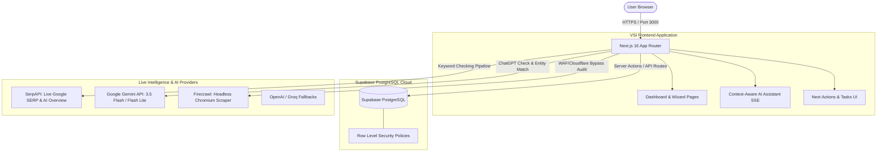
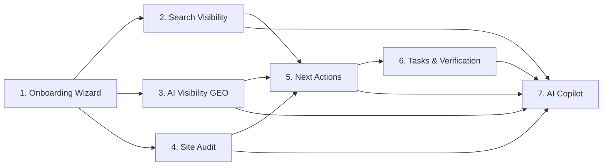
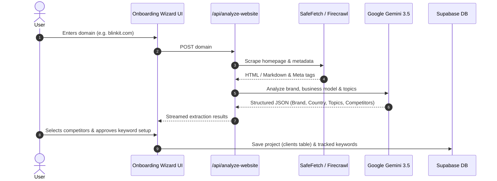
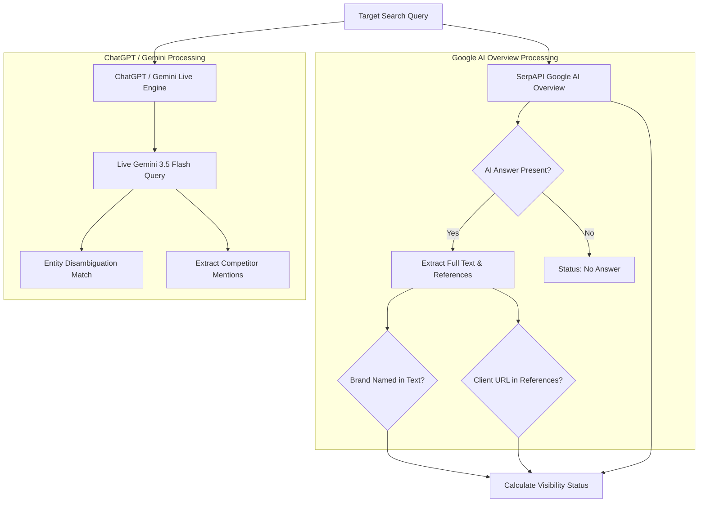
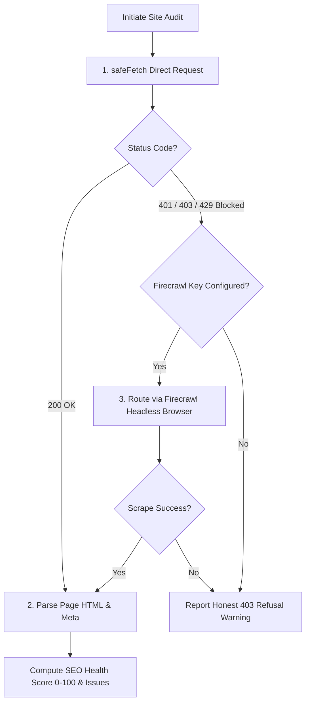
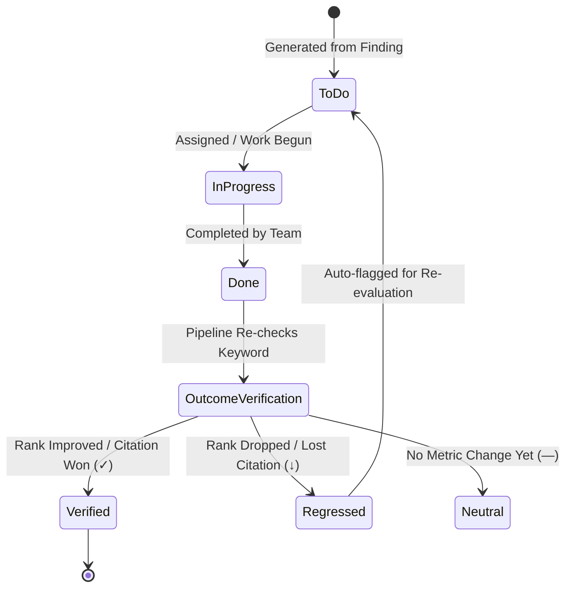
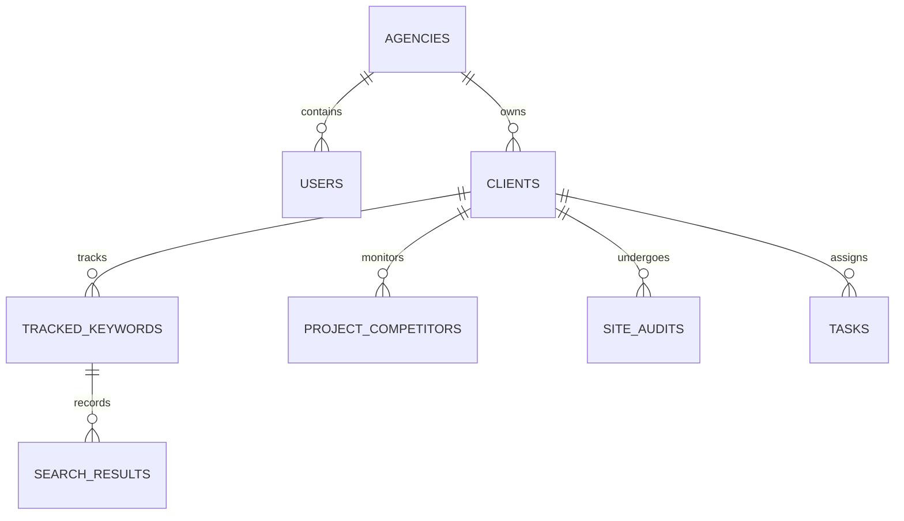

# Product Requirements Document (PRD)
# VSI — ValGrow Search Intelligence
### Enterprise Generative Engine Optimization (GEO) & Search Intelligence Platform

---

| **Document Version** | 2.5 (Production Specification) |
|---|---|
| **Product Name** | VSI — ValGrow Search Intelligence |
| **Status** | Approved & Implemented |
| **Document Owner** | Deepmind / Product Engineering Team |
| **Target Deployment** | Production Cloud (Vercel / Supabase / Edge Network) |
| **Tech Stack** | Next.js 16 (React 19) · TypeScript · Tailwind CSS v4 · Supabase PostgreSQL · SerpAPI · Google Gemini · Firecrawl |

---

## 1. Executive Summary & Vision

### 1.1 The Market Problem: The Death of the "10 Blue Links"
Search behavior has fundamentally shifted. When enterprise buyers, consumers, and researchers submit queries into Google, they are increasingly presented with **AI Overviews** (synthesized paragraph responses generated by AI) before encountering traditional organic search results. Concurrently, conversational AI engines such as **ChatGPT** and **Google Gemini** are directly answering queries without routing users through traditional search engine result pages (SERPs).

Traditional SEO rank-tracking tools (Ahrefs, SEMrush) only track positions within the classical blue links. They:
1. Do not capture or parse AI-generated answers.
2. Cannot determine whether a brand was cited as an authoritative source link or merely mentioned in text.
3. Cannot explain **why** an AI engine chose a competitor over the target brand.
4. Have zero automated feedback loop linking technical/content fixes to verified ranking and citation recovery.

### 1.2 The Solution: VSI (ValGrow Search Intelligence)
**VSI** is a next-generation **Search Intelligence and Generative Engine Optimization (GEO)** platform. It bridges classical organic SERP rank tracking with real-time AI answer analysis. VSI closes the loop between visibility intelligence and execution:

$$\text{Track} \longrightarrow \text{Diagnose} \longrightarrow \text{Plan} \longrightarrow \text{Execute} \longrightarrow \text{Verify}$$

VSI measures the **Rank-to-Citation Gap (R2C Gap™)**, audits website crawlability (including Cloudflare/WAF-protected enterprise domains via real browser fallbacks), turns technical/content deficiencies into prioritized **Next Actions**, and conducts automated **Outcome Verification** to prove that optimizations generated tangible business citations.

---

## 2. User Personas & Target Audience

| Persona | Role | Core Jobs to be Done | Key Value Delivered |
|---|---|---|---|
| **Agency Founder / Director** | SEO & Digital Agency Leadership | Deliver cutting-edge GEO & AI search reporting to retain enterprise retainers and prove ROI. | Automated multi-client dashboards, white-label intelligence, and outcome proof for clients. |
| **SEO Strategist / Specialist** | Agency Practitioner | Analyze why AI engines cite competitors; craft exact content briefs to win citations. | Detailed AI diagnosis, competitor source extraction, and automated citation briefs. |
| **Content & Engineering Team** | In-House Developers / Writers | Implement technical fixes and write targeted landing pages without guessing requirements. | Pre-filled task boards with concrete acceptance criteria and schema requirements. |
| **Client / CMO / Business Owner** | Executive Stakeholder | Understand brand visibility across Google & AI without navigating complex technical SEO jargon. | High-level visibility score, competitor share of voice, and plain-language action summaries. |

---

## 3. System Architecture & Tech Stack

### 3.1 Technology Specifications
- **Framework**: Next.js 16.2.6 with App Router, Turbopack / Webpack compilation engine.
- **Runtime**: Node.js v20+ / React 19.
- **Styling**: Tailwind CSS v4, `@tailwindcss/postcss`, Framer Motion animations.
- **Database & Auth**: Supabase PostgreSQL with comprehensive Row Level Security (RLS) policies across all tenant boundaries.
- **Search Provider**: SerpAPI (`engine=google`) providing raw Google Organic SERP and Google AI Overview JSON payloads.
- **AI Processing Engines**:
  - Primary: Google Gemini (`gemini-3.5-flash`, `gemini-3.5-flash-lite`, `gemini-3.6-flash`).
  - Secondary/Fallback: OpenAI (`gpt-4o-mini`), Groq (`llama-3.3-70b`), OpenRouter.
- **Web Crawling**: Native `safeFetch` (SSRF-protected, pinned DNS, direct HTTP streaming) + Firecrawl API (`https://api.firecrawl.dev/v1/scrape`) with stealth Chromium headless browser for WAF/Cloudflare bypass.
- **Security Headers**: Custom obfuscation headers masking server identity (`Server: VSI`, `X-Content-Type-Options: nosniff`, `X-Frame-Options: DENY`, `Strict-Transport-Security`).

---

## 4. Core System Modules & Functional Requirements

---

### Module 1: Automated Onboarding & Project Setup Wizard

#### Functional Goal
Enable any user to register a business domain and, within 60 seconds, auto-generate a complete intelligence profile including brand extraction, competitor discovery, country target, and high-value search queries.

#### Detailed Step Flow:
1. **Step 1: Website Analysis**:
   - User inputs domain (e.g., `blinkit.com`).
   - Server streams real-time status steps (`Fetching website...`, `Extracting metadata...`, `Analyzing business model...`).
   - Auto-extracts brand name, website description, target country, and content pillars.
2. **Step 2: Business Summary**:
   - Displays extracted business metadata. Allows manual override of brand name, location/market, and category.
3. **Step 3: Competitor Selection**:
   - Automated suggestion of top market competitors based on domain and geographic market.
   - Clean UI without redundant "Skip for now" links; users add manual competitors or proceed with `Continue ->`.
4. **Step 4: SEO & Keyword Setup**:
   - Generates initial high-intent keyword tracking list mapped to country code (`in`, `us`, `ae`, `gb`, etc.).
   - Triggers initial analysis and registers client project in database.

---

### Module 2: Search Visibility Engine (Google Organic SERP)

#### Functional Goal
Track organic Google rankings for client domains across targeted geographic locations with absolute zero synthetic or mock rankings.

#### Requirements & Capabilities:
- **Live Query Execution**: Calls SerpAPI with `engine=google`, query `q`, location `gl`/`hl`, and extracts up to 100 organic results.
- **Domain Extraction & Google Redirect Unwrapping**:
  - Unwraps Google redirect tokens (`https://www.google.com/goto?url=...` and `/url?q=...`).
  - Reads `displayed_link` (`https://medium.com › ...` $\rightarrow$ `medium.com`) and `source` tags.
  - Guarantees competitor domains never collapse into `google.com`.
- **Ranking Metrics**:
  - `googleRank`: Client position (1 to 100, or `null` if not found).
  - `rankingUrl`: Precise landing page URL ranking on Google.
  - `rankingTitle`: Exact SERP page title.
  - `serpFeatures`: Detection of Knowledge Graph, Answer Box, People Also Ask, Video Packs, and Top Stories.

---

### Module 3: AI Visibility Engine (GEO — Generative Engine Optimization)

#### Functional Goal
Determine whether, how, and why AI search engines (Google AI Overview, ChatGPT, Gemini) mention or cite the client's brand.

#### Detailed Gap Classification Matrix:
The engine applies deterministic logic to categorize each keyword:

| Classification Status | Google Rank | Mentioned in AI Text | Cited as AI Source | Meaning & Impact |
|---|---|---|---|---|
| 🟢 **Winning** | Ranked (1-10) | Yes | Yes | **Dominant**: Client captures organic search and AI citations. |
| 🔵 **AI Mention Only** | Any / Not Ranked | Yes | No | **Partial**: Brand is named by the AI, but competitor websites get all referral traffic links. |
| 🟣 **AI Citation Only** | Unranked | No | Yes | **Stealth Win**: AI links to client even though client ranks poorly in traditional organic SERP. |
| 🟡 **AI-Invisible** | Ranked (1-10) | No | No | **High Risk**: Client ranks on Google page 1, but AI completely ignores them and directs users to competitors. |
| 🔴 **Not Capturing** | Unranked | No | No | **Opportunity Loss**: Competitors own the conversation across both Google and AI. |

#### Rank-to-Citation Gap (R2C Gap™):
$$\text{R2C Gap} = \text{Google Rank} - \text{AI Citation Position}$$
- Positive gap indicates the client ranks lower on Google but wins an AI citation (beating organic algorithms).
- Negative gap highlights competitors winning citations despite inferior organic ranking.

#### Entity Disambiguation:
When a brand name is mentioned in AI text, a secondary AI pass confirms whether the AI was discussing **this specific client brand** or an unrelated entity that shares the same name, preventing false-positive brand equity tracking.

---

### Module 4: Enterprise Site Audit Engine

#### Functional Goal
Audit client websites for crawlability, technical SEO health, robots.txt bot rules, XML sitemaps, internal link health, and accessibility.

#### Cloudflare & WAF Bypass Architecture:
Many major enterprise websites (e.g., Blinkit, Netflix) employ Cloudflare WAF or anti-bot shields that block standard Node.js/cURL HTTP crawlers with `HTTP 403 Forbidden` (`cf-mitigated: challenge`).

#### Audited Parameters & Health Score (0–100):
1. **Robots.txt Analysis**: Checks if AI bots (`GPTBot`, `CCBot`, `Google-Extended`) or general search crawlers are blocked.
2. **Sitemap Verification**: Discovers and validates XML sitemaps and child sitemaps.
3. **Core Meta & Page Hygiene**:
   - Title tag length (30–60 chars).
   - Meta description presence and length (70–160 chars).
   - Single `<h1>` tag presence and hierarchy.
   - Canonical tag correctness.
   - Image `alt` attribute coverage.
4. **Internal Link Verification**: Probes up to 60 internal links with `HEAD` requests to detect 404 broken links.
5. **Crawl Depth & Response Latency**: Measures page response times in milliseconds.

---

### Module 5: Next Actions & Opportunity Engine

#### Functional Goal
Convert raw telemetry data from Site Audits, Search Visibility, and AI Citations into an actionable, prioritized backlog of tasks.

#### Priority Ranking Logic:
Findings are scored and sorted based on direct revenue/visibility risk:
1. **Critical Technical Blockers**: Entire site blocking crawlers via `robots.txt`, or homepage HTTP 500/403.
2. **AI Citation Leakage**: Keywords where client ranks in Google top 3 but competitors steal 100% of AI citations.
3. **Missing Business Identity**: Missing Organization schema markup, contact, or business name structured data.
4. **Unranked High-Intent Keywords**: High-search-volume keywords with zero organic or AI visibility.
5. **On-Page Hygiene**: Missing meta descriptions, duplicate H1s, broken links.

Every finding provides a direct **"Create task"** action that pre-fills task titles, descriptions, and acceptance criteria.

---

### Module 6: Task Execution & Closed-Loop Outcome Verification

#### Functional Goal
Ensure SEO and GEO tasks are not merely marked "done," but are autonomously verified against live search engines to prove outcome success.

#### Verification Rules:
- **Verified (✓)**: Google rank improved by $\ge 2$ positions, or keyword moved from "AI-Invisible" to "Winning/Cited".
- **Regressed (↓)**: Google rank dropped or citation was lost after the task completion date.
- **Neutral (—)**: SERP position remained stable within margin of error.

---

### Module 7: Context-Aware AI Chat Copilot

#### Functional Goal
Provide an interactive AI copilot embedded in every dashboard view that answers questions using the exact data of the active project and page.

#### Specifications:
- **Streaming UI**: Implemented via Server-Sent Events (SSE) with typing chunk animation.
- **Engine**: Powered by Google Gemini 3.5 Flash for ultra-low latency (<800ms time-to-first-token).
- **Scope Awareness**: Automatically injects current view context:
  - Overview context (Health score, total tracked keywords, citation share).
  - Site Audit context (Broken pages, crawler blockers, missing tags).
  - AI Visibility context (Mentioned queries, competitor citation counts).
- **Multilingual Support**: Answers natively in **English**, **German**, **Tamil**, or **Sinhala** based on user preference.

---

### Module 8: Multi-Tenant Architecture & Super Admin Controls

#### Multi-Tenant Hierarchy:
$$\text{Platform} \longrightarrow \text{Agencies (Organizations)} \longrightarrow \text{Users (Members)} \longrightarrow \text{Clients (Projects)}$$

- **Super Admin**: Global overview of all agencies, platform-wide API credit consumption, prompt engineering studio, and error logs.
- **Agency Admin**: Manages team members, client projects, API credentials, and billing limits.
- **Agency Member**: Can execute checks, run audits, and create/complete tasks for assigned clients.
- **Client Viewer**: Read-only access to specific client dashboards and reports.

---

## 5. Database Schema & Data Models

All data is housed in Supabase PostgreSQL, secured by Row-Level Security (RLS) ensuring strict tenant isolation.

### Key Tables & Columns:

#### `clients` (Projects)
- `id` (UUID, PK)
- `agency_id` (UUID, FK $\rightarrow$ agencies)
- `name` (TEXT)
- `website` (TEXT)
- `location` (TEXT, e.g. "India", "United States")
- `location_code` (TEXT, e.g. "in", "us")
- `rank_tracking_enabled` (BOOLEAN)
- `ai_mode_enabled` (BOOLEAN - controls AI Overview tracking)
- `chatgpt_enabled` (BOOLEAN - controls conversational AI checks)

#### `tracked_keywords`
- `id` (UUID, PK)
- `client_id` (UUID, FK $\rightarrow$ clients)
- `keyword` (TEXT)
- `location` (TEXT, country code)
- `track_type` ("rank" | "geo" | "both")
- `is_active` (BOOLEAN)

#### `search_results`
- `id` (UUID, PK)
- `tracked_keyword_id` (UUID, FK $\rightarrow$ tracked_keywords)
- `client_id` (UUID, FK $\rightarrow$ clients)
- `created_at` (TIMESTAMPTZ)
- `rank_position` (INT, nullable)
- `ranking_url` (TEXT)
- `aio_present` (BOOLEAN)
- `mentioned_in_text` (BOOLEAN)
- `client_cited` (BOOLEAN)
- `cited_domains` (TEXT[])
- `chatgpt_brand_mentioned` (BOOLEAN)
- `chatgpt_brand_cited` (BOOLEAN)
- `chatgpt_competitors` (TEXT[])
- `rank_status` ("found" | "not_found" | "check_failed")
- `check_provenance` (JSONB - engine, provider, model, timestamp)

#### `site_audits`
- `id` (UUID, PK)
- `client_id` (UUID, FK $\rightarrow$ clients)
- `domain` (TEXT)
- `score` (INT, 0-100)
- `status` ("completed" | "partial" | "failed")
- `pages_scanned` (JSONB)
- `checks` (JSONB)
- `broken_links` (JSONB)
- `failure_reason` (TEXT)

#### `tasks`
- `id` (UUID, PK)
- `client_id` (UUID, FK $\rightarrow$ clients)
- `tracked_keyword_id` (UUID, nullable)
- `title` (TEXT)
- `description` (TEXT)
- `status` ("todo" | "in_progress" | "done" | "skipped")
- `outcome_status` ("verified" | "regressed" | "neutral" | null)
- `acceptance_criteria` (JSONB)

---

## 6. Data Integrity & Anti-Hallucination Policy

VSI strictly prohibits the generation or display of simulated, fake, or synthetic data.

1. **No Synthetic Search Results**:
   - If `SERPAPI_KEY` is missing or fails, VSI raises a typed `ProviderUnavailableError`. It never invents rank positions.
2. **Explicit Provenance Logging**:
   - Every recorded observation in `search_results` stores its `check_provenance` (which provider, which engine, which model, and the exact timestamp).
3. **Graceful Error States**:
   - If an external provider is rate-limited or fails, VSI reports the honest status (`check_failed` / `Not checked`) rather than marking the brand as "not ranking" or "not mentioned."

---

## 7. Non-Functional Requirements (NFRs)

| Category | Requirement | Specification |
|---|---|---|
| **Performance** | Page Initial Load Time | Dashboard loads in under **1.8s**; sub-queries cached with React `cache()`. |
| **Throughput** | Keyword Batch Checks | Parallel batch execution with rate limit pacing (3 keywords per batch). |
| **Security** | SSRF & Internal IP Protection | All outbound crawler requests run through `safeFetch` with pinned public IP validation (private CIDR, localhost, cloud metadata blocked). |
| **Isolation** | Tenant Data Segregation | Enforced via PostgreSQL Row-Level Security (`auth.uid()` and `agency_id` checks). |
| **Availability** | Server Uptime | 99.9% uptime target via edge-distributed serverless functions. |
| **Browser Compatibility** | Webpack Dev Server | Verified on Windows, macOS, and Linux without native Turbo IPC process panics. |

---

## 8. Product Roadmap & Future Milestones

### Phase 1: Core Intelligence & GEO Stabilization (Completed)
- [x] Live Google SERP and Google AI Overview tracking via SerpAPI.
- [x] Live ChatGPT / Gemini AI visibility checking with entity match verification.
- [x] Next Actions prioritized backlog.
- [x] Enterprise Site Audit with Cloudflare/WAF bypass via Firecrawl fallback.
- [x] Outcome verification for completed tasks.
- [x] Delete Project with confirmation modal.
- [x] Elimination of all hardcoded mock answers.

### Phase 2: Autonomous Intelligence & Outreach (Next Milestone)
- [ ] **Perplexity AI Engine**: Real-time citation tracking on Perplexity Sonar.
- [ ] **Automated Citation Gap Outreach**: One-click outreach brief generation for digital PR teams targeting domains that cite competitors.
- [ ] **Automated PDF / White-Label Client Reports**: Scheduled weekly PDF digests sent directly to client stakeholders.
- [ ] **Multi-Location Local Map Pack Tracker**: Geo-coordinate rank tracking for hyper-local businesses.

---

*End of Product Requirements Document.*
